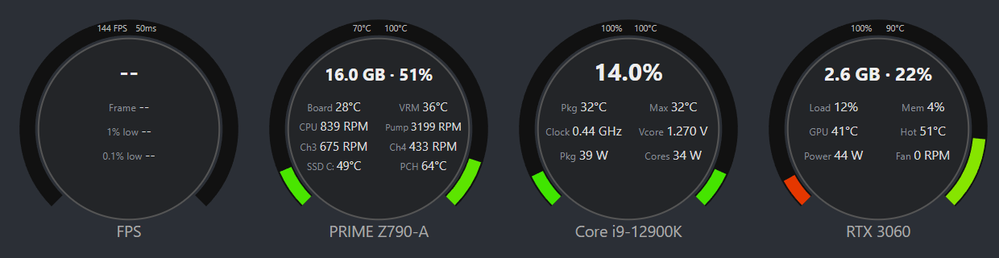
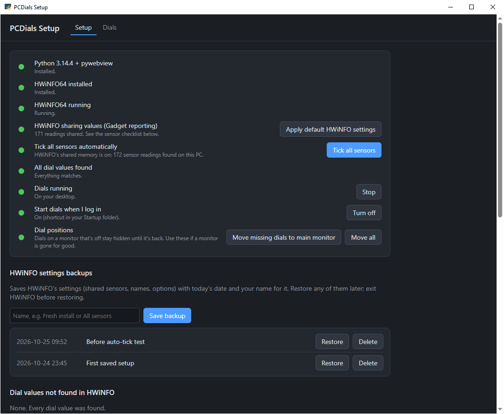
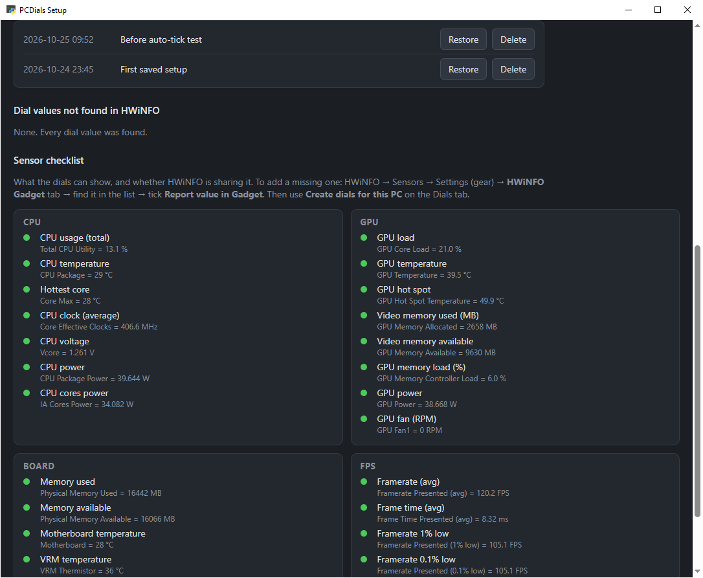
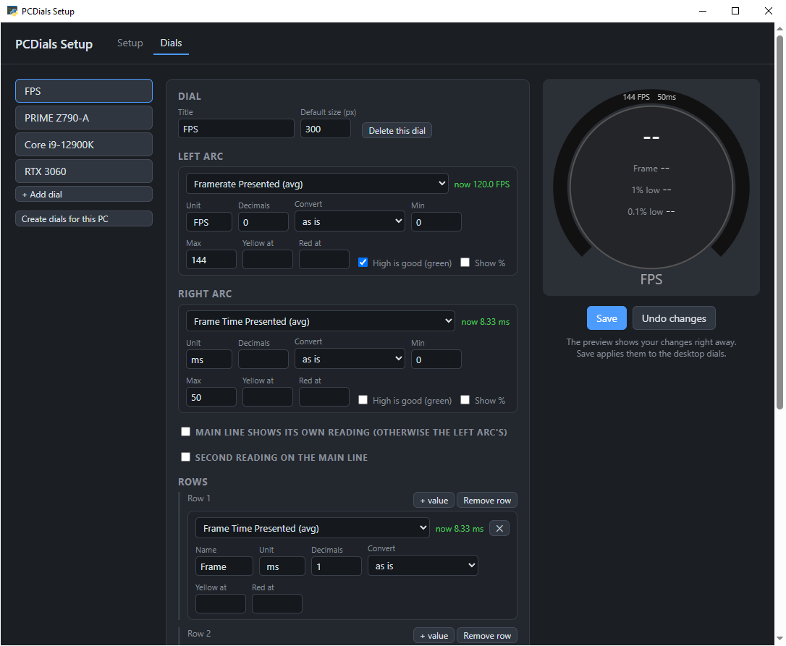
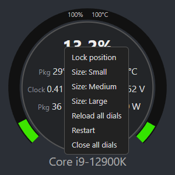

# PCDials

Live PC monitoring dials for the Windows desktop: **FPS**, **motherboard**, **CPU** and **GPU**,
fed by [HWiNFO64](https://www.hwinfo.com/) (free). Each dial is its own small see-through widget:
drag it anywhere, on any monitor, and it stays there.



- **Live values every second**, with arcs that fill green → yellow → red.
- **Warnings:** values turn **yellow** near a limit and **bold red** past it (temperatures,
  fan/pump stopping, RAM and video memory nearly full).
- **Any hardware:** one click builds dials for your own CPU, GPU and motherboard
  (Intel/AMD CPUs, NVIDIA/AMD GPUs, common boards).
- **Stays out of the way:** sits behind your windows, never takes focus (safe while gaming),
  no taskbar button, just a small tray icon.
- **Multi-monitor aware:** dials on a monitor that's switched off stay hidden and come back
  in the same spot when it's on again.
- **Easy to change:** a Setup window to edit every dial, with a live preview. No code needed.

---

## Requirements

- Windows 10 or 11
- [HWiNFO64](https://www.hwinfo.com/) (free version is fine)
- Python 3.13 or newer, with [pywebview](https://pywebview.flowrl.com/)

`Install.bat` installs all three for you if they're missing.

---

## Install (step by step)

### 1. Download

On this page click **Code → Download ZIP**, and unzip it somewhere permanent, e.g.
`D:\PCDials`. (Or `git clone https://github.com/DFranke84/PCDials.git`.)

### 2. Run `Install.bat`

Double-click **`Install.bat`**. It checks for and installs whatever is missing, using Windows'
built-in installer (winget):

```
 ===== PCDials installer =====

 [OK]  Python: C:\Users\you\AppData\Local\Programs\Python\Python314\python.exe
 [..]  HWiNFO64 not found. Installing (Windows may ask for permission)...
 [OK]  HWiNFO64 installed
 [..]  Installing pywebview...
 [OK]  pywebview installed

 Opening PCDials Setup...
```

- **Python** is installed just for you (no admin needed).
- **HWiNFO64**: Windows may ask for permission.
- Then the **PCDials Setup** window opens.

`Install.bat check` only reports what's installed and changes nothing.

### 3. Set up HWiNFO (automatic)

The **Setup** tab shows a checklist with a fix button for each item. Green means done:



1. **Start HWiNFO64** (button in Setup). The first time, HWiNFO asks how to run: choose
   **Sensors-only**, then **Start**.
2. In HWiNFO, turn on **Shared Memory Support**: **Sensors** window → **Settings** (gear icon)
   → **General** tab → tick **Shared Memory Support** → **OK**.
   *(Free. In the free version it switches itself off after 12 hours. That's fine: it's only
   needed for this step.)*
3. In Setup click **Tick all sensors**. Setup reads every sensor your PC has, then says:
   *"Now exit HWiNFO64 (tray icon → Exit)."*
4. **Exit HWiNFO**: right-click its tray icon → **Exit**. Within a few seconds Setup ticks every
   sensor for sharing, turns on HWiNFO's Gadget reporting, and sets HWiNFO to open as
   Sensors-only, minimized, and to start with Windows.
5. **Start HWiNFO64** again. Scroll down: the **Sensor checklist** should be all green.



<details>
<summary>Without shared memory (manual way)</summary>

Exit HWiNFO, click **Apply default HWiNFO settings** (ticks the sensors that are the same on
every PC: memory, FPS, CPU totals, Intel CPU, NVIDIA GPU), start HWiNFO, then tick anything
still yellow in the Sensor checklist by hand: HWiNFO → **Sensors → Settings (gear) → HWiNFO
Gadget** tab → select the sensor → tick **Report value in Gadget** → **OK**.
</details>

### 4. Save a backup of HWiNFO's settings

Under **HWiNFO settings backups**, type a name (e.g. *Fresh install, all sensors*) and click
**Save backup**. You can keep as many as you like and **Restore** any of them later.

### 5. Create your dials

Open the **Dials** tab and click **Create dials for this PC**. It builds four dials for your
hardware with sensible warning limits. Check them in the preview on the right, change anything
you like, then click **Save**.



> The `dials.json` included in this repo is an example for an Intel i9-12900K, RTX 3060 and
> ASUS PRIME Z790-A. **Create dials for this PC** replaces it with dials for your hardware.

### 6. Start the dials

Back on the **Setup** tab: click **Start** next to *Dials running*, and **Turn on**
*Start dials when I log in*. The dials appear at the top-left of your main monitor. Drag
them where you want them; each one remembers its spot.

---

## Using the dials

| | |
|---|---|
| **Move** | Drag a dial. Its position is saved. |
| **Right-click a dial** | Lock position, Size (Small / Medium / Large), Reload all dials, Restart, Close all dials |
| **Tray icon** (small green gauge, maybe under the **^** arrow) | Right-click: Open PCDials Setup, Lock all / Unlock all dials, Reload, Restart, Close dials. Double-click: open Setup |
| **Start by hand** | Double-click `Start.bat` (does nothing if they're already running) |



**What the dials show** (as created for an Intel + NVIDIA PC):

- **FPS:** frames per second of the game in front (left arc; green is good), frame time
  (right arc), 1% and 0.1% lows. Desktop programs (browsers, Discord, Steam…) are ignored,
  so it shows `--` when no game is running.
- **Motherboard:** RAM in use (GB and %), board and VRM temperature arcs, CPU fan, AIO pump,
  case fans, Windows SSD and chipset temperatures. The pump and CPU fan warn when they
  *slow down*.
- **CPU:** total usage (as in Task Manager) and package temperature arcs; hottest core,
  clock, voltage and power.
- **GPU:** video memory in use (GB and %; important for running AI models on the GPU), load
  arc (green near 100% means it's working fully, e.g. in games), temperature arc, hot spot,
  memory load, power and fan.

**Colours:** arcs go green → yellow → red as they fill (reversed where high is good: FPS and
GPU load). Values turn **yellow** near a limit and **bold red** past it.

**Multiple monitors:** positions are saved in real screen pixels, so dials come back exactly
where you left them, whatever each monitor's scaling. A dial on a monitor that's off stays
hidden until the monitor is back. If you remove a monitor for good, use **Move missing dials
to main monitor** in Setup.

---

## Changing the dials

Use the **Dials** tab in Setup: pick a reading from the list of everything HWiNFO shares (with
its live value), set units, ranges and yellow/red limits, add or remove rows and dials.
**Save** updates the running dials within a couple of seconds. **Undo changes** goes back to
what's saved.

<details>
<summary>Editing <code>dials.json</code> by hand</summary>

Each dial has:

- `title`, `size` (pixels; the right-click size overrides it)
- `left` / `right`: the two arcs; `min` / `max` set the range
- `big` (optional): what the big line shows; otherwise the `left` reading
- `bigExtra` (optional): a second reading added to the big line
- `rows`: lines of one or two values
- `ignoreApps`, `showApp` (FPS dial): programs whose FPS to ignore; show the game's name

Each value can use:

| Setting | Meaning |
|---|---|
| `label` | HWiNFO's name for the reading (exactly as shown in HWiNFO) |
| `source` | Text from the sensor group, when the same label appears more than once (e.g. `"DTS"`, `"[C:]"`) |
| `hwunit` | HWiNFO's own unit, when the value is shown converted (e.g. `"MB"` shown as GB) and the label is shared |
| `name` | Short dimmed name shown before the value |
| `unit`, `decimals` | How the number is shown |
| `scale` | Multiply first (e.g. `0.0009765625` turns MB into GB) |
| `showPercent` | Also show the % between `min` and `max` |
| `warn`, `danger` | Turn yellow / red at these values. If `danger` is lower than `warn`, *low* is bad (pump, fans) |
| `invert` | Arc colours reversed: high = green |

The running dials pick up changes to `dials.json` by themselves. To see every reading HWiNFO
shares, open <http://127.0.0.1:8765/data> while the dials are running.
</details>

---

## HWiNFO settings backups

**Save backup** stores HWiNFO's settings (which sensors are shared, renamed sensors, options)
in `hwinfo-backups\<date time> - <name>\`. **Restore** puts one back exactly (exit HWiNFO
first); your current settings are saved as a *Before restoring …* backup first, so a restore
can always be undone. **Delete** moves a backup to the Recycle Bin.

Backups only fit the PC they were saved on (HWiNFO ties its settings to the hardware). On a
new PC, use **Tick all sensors**. Backups stay on your PC and aren't part of this repo.

---

## Troubleshooting

| Problem | Fix |
|---|---|
| Dials show `--` | HWiNFO isn't running, or isn't sharing that reading. Setup → *Sensor checklist* shows what's missing. |
| FPS dial shows `--` | Normal with no game running. If a game shows `--`: in HWiNFO make sure PresentMon (FPS) monitoring is on. |
| A program that isn't a game appears after "FPS ·" | Add it to *Ignore these programs* (Dials tab → FPS) |
| Dials disappeared | Their monitor may be off. Otherwise tray icon → Restart, or `Start.bat`. Setup → *Move all* brings every dial to the main monitor. |
| Dials stopped on their own | `pcdials.log` in the PCDials folder records starts, stops and errors. |

<details>
<summary>Command-line tools</summary>

```
python tools.py check                 list any dial value HWiNFO isn't sharing (and suggest fixes)
python tools.py backup-hwinfo [name]  save HWiNFO's settings as a dated, named backup
python tools.py list-backups          list the saved backups
python tools.py restore-hwinfo [name] restore a backup (newest if no name; exit HWiNFO first)
python tools.py auto-tick             tick every sensor this PC has (needs HWiNFO's shared memory)
python tools.py default-hwinfo        standard settings for a NEW HWiNFO install (exit HWiNFO first)
python autodials.py                   print dials generated for this PC (changes nothing)
python helper.py --server             serve the data only; preview at http://127.0.0.1:8765/dial.html?i=0&preview
```
</details>

---

## Files

| File | What it is |
|---|---|
| `Install.bat` | Installs Python, HWiNFO64 and pywebview if missing, then opens Setup |
| `Start.bat` | Starts the dials (does nothing if they're already running) |
| `setup.py`, `setup.html` | The PCDials Setup window |
| `helper.py` | The dials app: reads HWiNFO, one window per dial, tray icon |
| `dial.html` | How a dial is drawn (shared by all dials) |
| `dials.json` | Which values each dial shows, ranges, warning limits |
| `autodials.py` | Builds dials for any PC's hardware |
| `tools.py` | HWiNFO setup, backups and checks |
| `positions.json`, `pcdials.log`, `hwinfo-backups\` | Created on your PC (where dials sit, log, backups); not in the repo |

**How it works:** HWiNFO publishes the sensors you tick to the Windows registry ("Gadget
reporting"). `helper.py` reads them once a second and serves them on `127.0.0.1:8765` (local
only); each dial is a small borderless, see-through [pywebview](https://pywebview.flowrl.com/)
window drawing an SVG gauge.
